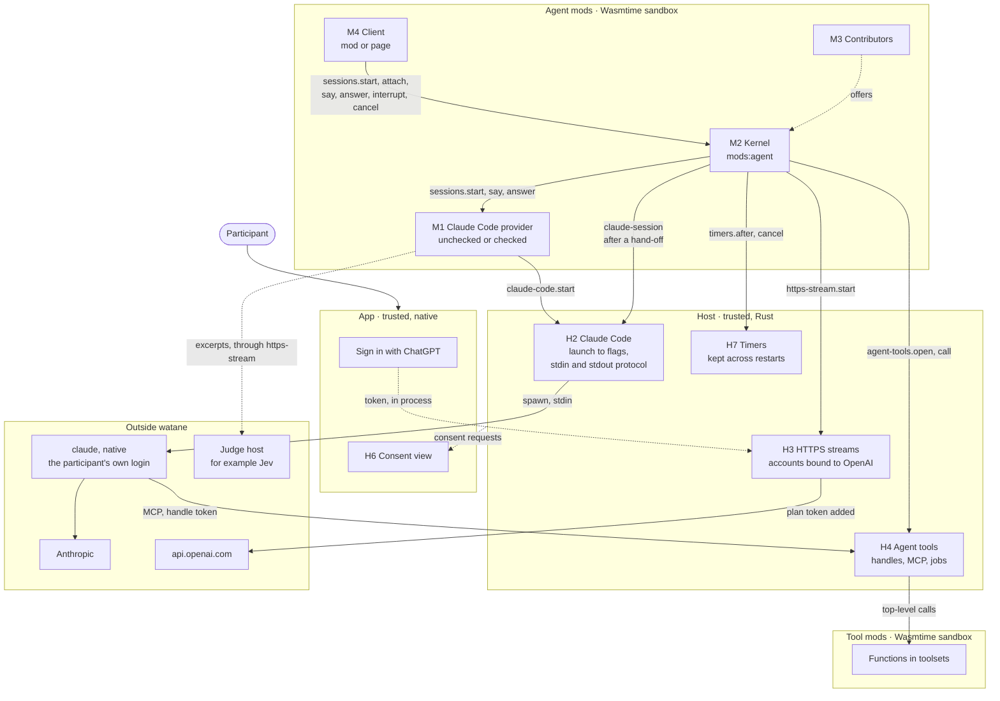
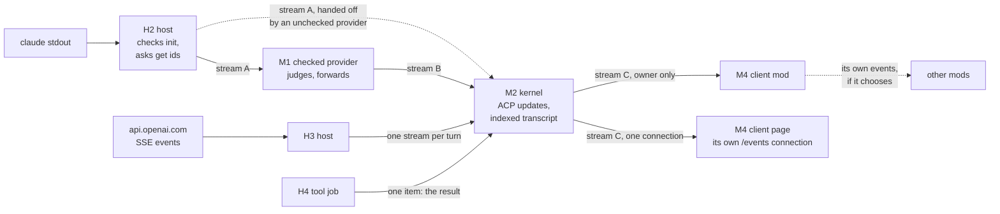
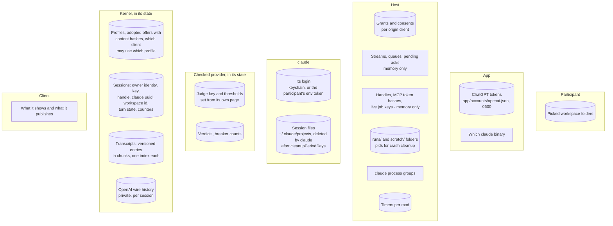
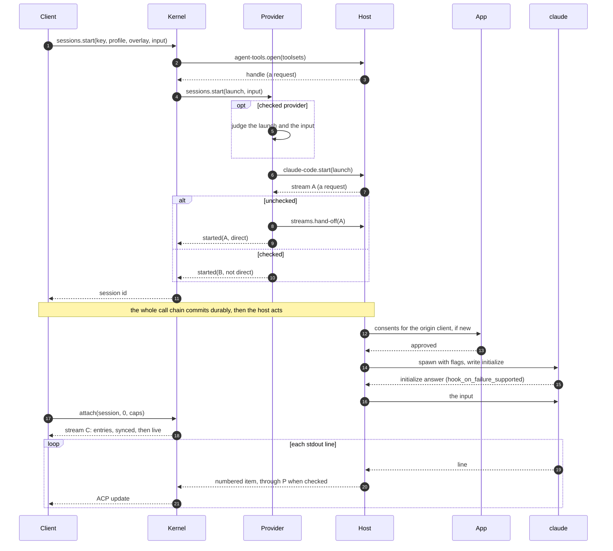
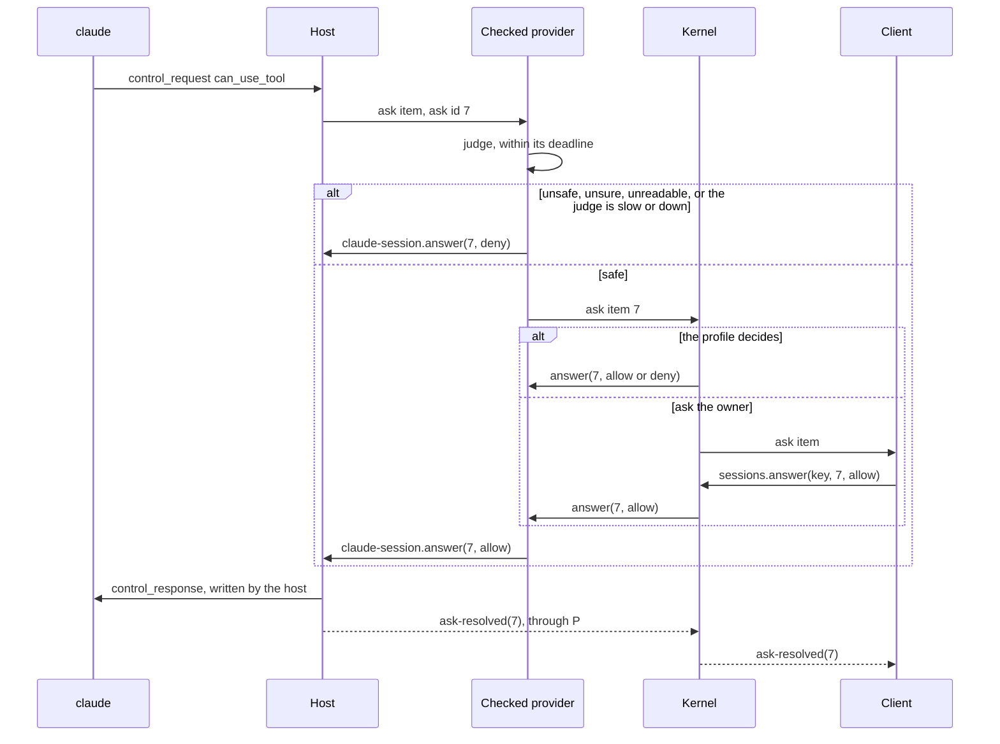
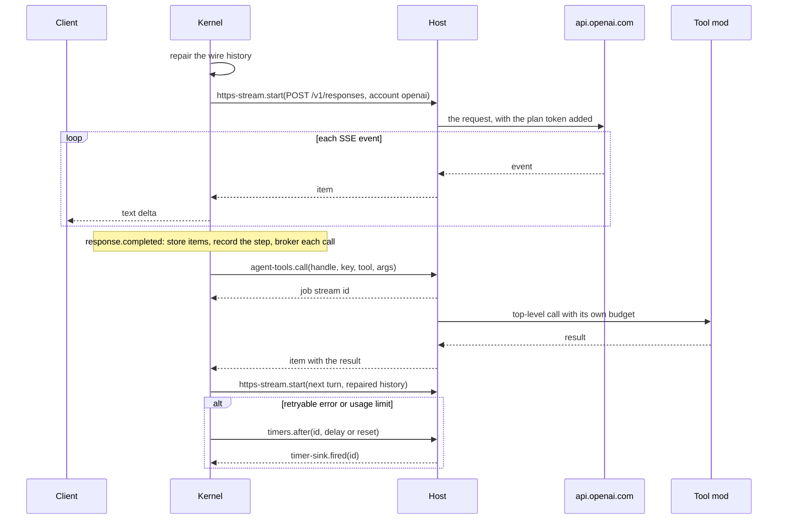

# The agentic layer: architecture proposal (revision 4, 2026-11-20)

A record, not a contract. Revision 2 took the human's decisions (section 14).
Revision 3 answered the adversarial review (`REVIEW-2026-11-20.md`; section
16). Revision 4 takes the lessons of nine comparisons with existing harnesses
(`COMPARISON-harness-summary-2026-11-20.md` and the files it lists) and the
probes V16 to V25 (section 18); section 19 maps each lesson to its answer.
The accepted parts move into `spec/TECHNICAL.md`, `spec/FUNCTIONAL.md`,
`host/TECHNICAL.md`, `pkg/TECHNICAL.md` and the documents of the new mods when
a design slice takes this up. Evidence: `research_notes/calling-agents.md`,
`proto/agent-spike/`, `proto/claude-probes/`, `proto/stream-cost-bench/`.
Drafts of the layer's own documents, distilled from this record: `VISION.md`,
`FUNCTIONAL.md` and `TECHNICAL.md` in this folder.

**What changed in revision 4, in short.**
- **Claude side doors closed.** A leading `/` in a message runs any skill,
  denied or not (V16): the host refuses it. A subagent's own
  `permissionMode` escalates (V21): subagent keys are a closed list. Hooks
  fail open unless told otherwise (V17): the host's hook blocks on failure.
  A hook `allow` beats the permission mode (V25): the judge's "safe" sends no
  decision.
- **Every repeat is harmless.** Client keys on `start`, `say` and `answer`;
  job keys; numbered stream items with redelivery; a step is recorded before
  its jobs run; only idempotent tools run again after a restart (3, 6, 10).
- **Waits belong to the host.** A new host part H7 keeps timers across
  restarts for retries, ask expiry and usage-limit resets (7a).
- **The OpenAI loop is a state machine with a private wire history.** It
  repairs orphaned tool calls before each request, replays reasoning only
  with its encrypted content, compacts on the server and keeps
  `instructions` byte-stable for the cache (10.3, V23).
- **Sessions grow up.** Turn states and stop reasons, an end-of-replay
  marker, versioned entries, list, rename, delete, quotas, delegation that
  only narrows, and Claude fork and rewind (10, V20).

## 1. Goals and rules

- **G1 Small host, but the host owns every boundary.** The host does what a
  sandboxed mod cannot do or must not be trusted with: start a native process,
  speak to it, hold a credential, mint a token, touch the file system, ask the
  participant, keep time across restarts, and deliver data to one consumer
  only. Revision 2 kept the host out of Claude's protocol; the review showed
  that stdin is a settings channel, so the host owns that protocol (4.3).
- **G2 The rest is mods.** Every agent mod is downloadable like any other mod
  (D5). The host knows none of them.
- **G3 Fine control.** Each profile fixes its skills, tools, permissions,
  system prompt, subagents, model, limits and output schema.
- **G4 Claude CLI is the envelope.** Every setting that reaches a backend is a
  flag, a settings key, or a field of the host's own `initialize` that
  `claude -p` accepts on a subscription. The host turns a launch document into
  those; nothing else reaches `claude`, before or during the session.
  Another backend runs a profile only if it honours each field that the
  profile sets, and refuses it otherwise. (Revision 4 names `initialize`: the
  host's hook callbacks always went that way. N9.)
- **G5 Subscriptions, no API keys.** Claude runs as the unmodified `claude`
  binary under the participant's own login; the host never reads that login.
  OpenAI runs on Sign in with ChatGPT tokens that only the host uses, and only
  towards OpenAI.
- **G6 Private by default.** A session's output goes only to the client that
  started it (D4).
- **G7 Authority follows the origin.** A consent names the client that started
  the chain of calls, and holds for that client only. A mod in between (a
  provider, the kernel) gains nothing from it.
- **G8 Limits live in code, and every unknown fails closed.** Every limit the
  harnesses kept in a prompt or a per-agent list failed somewhere (research,
  lesson 1). So turn, tool-error, token and subagent limits are counted by the
  kernel or set by the host; a hook that fails blocks; an ask nobody can
  answer is a deny; an unknown entry kind is kept as `unreadable`, never
  guessed.

## 2. Components

### 2.1 Who calls whom

Solid arrows are calls and starts; dotted arrows are offers, consent requests
and the judge's traffic. Every host effect is a request (H5): it applies only
when the call chain that asked for it commits.



Every arrow back (lines, events, results, timer firings) travels as a stream
item through H1 (2.2), or as a `timer-sink.fired` call (7a).

### 2.2 Where items flow

A stream has exactly one consumer. A client sees its own sessions and nothing
else; it publishes events only if it chooses.



### 2.3 Who owns what



Nobody else holds a copy:
- **The Claude login** stays with `claude`.
- **The ChatGPT tokens** stay with the app. The host only borrows one per
  request.
- **MCP tokens** exist only in the host's memory and on `claude`'s inherited
  pipe.
- **No mod sees any credential** except the checked provider's own judge key
  (N10 would move that to the host too).

| # | Component | Where | Responsible for |
|---|---|---|---|
| H1 | Streams | host, `watane:host/streams` | Roles, numbered delivery and redelivery, backpressure, ends, limits (3) |
| H2 | Claude Code | host, `watane:host/claude-code`, `claude-session`, `claude-types` | Validate a launch, build the flags, start and stop `claude`, speak its control protocol, check `initialize` and `init`, turn asks into items (4) |
| H3 | HTTPS streams | host, `watane:host/https-stream` | One request, SSE events as items, an idle timeout, plan tokens towards OpenAI only (5) |
| H4 | Agent tools | host, `watane:host/agent-tools`, MCP (host 10) | A handle per session, its MCP token, keyed tool calls as jobs (6) |
| H5 | Requests | host | Every host effect returns an id at once and applies when the whole call chain commits, durably first (7) |
| H6 | Consent | app | Grants, folder picks, accounts and toolsets, each for one origin client (8) |
| H7 | Timers | host, `watane:host/timers` | Fire a mod's timer after a delay, across restarts; never inside a call (7a) |
| M1 | Claude Code provider | mod | Holds the Claude Code grant. Unchecked: starts and hands off. Checked: judges before each step (9) |
| M2 | Kernel `mods:agent` | mod | Profiles, compilation, sessions and turns, protocol mapping, permission broker, the OpenAI loop, delegation (10) |
| M3 | Contributors | any mod | Offer skills and profiles; offer functions for toolsets |
| M4 | Clients | any mod or page | Start sessions, read their streams, answer asks, publish if they choose |

## 3. H1, streams

A **stream** carries items from one producer to one consumer, in order.

**Roles.**
- **Host-produced streams.** The producer is the host (H2, H3, H4). The
  consumer is the mod that made the request that opened it.
- **Mod-produced streams.** A mod opens a stream with `streams.open` only
  during a call that another mod or its own page made through a call link: not
  during an event delivery, a collect, or an MCP call. The consumer is that
  caller, taken from the transport.
- **Page consumers.** A page consumer is one `/events` connection: the page
  passes its connection id with its `/call` (3, Pages).

**Operations and checks.**
- `push` and `close` are for the producer only; `cancel` is for the consumer
  only.
- `hand-off` gives a host-produced stream to the caller of the current call.
  Only its consumer may hand it off, and only once.
- Every other caller gets `not-yours`. An unknown or ended id gets
  `unknown-stream`.

**Ids.** 128 random bits, never reused, never shown to a third mod: an agent
tool's caller is the session handle (6), never a stream id.

**Delivery.**
- **Numbered items.** Each item carries its sequence number in its stream,
  from 1. A consumer can drop an item it has already seen.
- **Batches.** Each consumer has one FIFO queue. A worker delivers items in
  order, in batches: each call carries every item that is waiting for that
  consumer, up to 256 items or 1 MiB, with the normal per-call budget (Q1).
  When the consumer keeps up, a batch holds one item and the delay stays low.
  When it falls behind, the batches grow, so the number of calls (and of
  state commits) stays bounded.
- **Why batches.** Measured on this Mac (V6): a call that writes nothing
  costs about 20 µs. A call that writes costs about 4 ms, almost all of it one
  `F_FULLFSYNC` per redb commit. One redb file serves the whole host, with one
  writer at a time, so writing calls cap at about 240 per second for all mods
  together. One writing call per item, three layers deep, would spend 3.6 s of
  that writer on one 300-delta OpenAI turn and stall every other mod's writes.
- **A failed batch.** The items leave the queue only when the consumer's
  `stream-sink.items` call commits. If the call fails, the same batch, with
  the same numbers, is delivered once more; if that fails too, the stream ends
  with `consumer-failed`. (Restate had this duplicate race on attach, #5375;
  Golem counts effects, not returns.)
- An item call's caller is `host` for host streams and `mod:<producer>` for
  mod streams.
- Items pushed in a call are queued only when that call commits; a failed
  call's pushes are dropped.
- An item call that pushes to another stream passes on its hop count. At 8
  hops the item is dropped and logged, as for events (host 9).
- **Forwarding writes nothing.** A call with no writes commits nothing (and,
  with the no-op commit fix on `claude/kind-ptolemy-e44ee5`, not yet merged,
  neither does a write of an unchanged value). The
  checked provider forwards without writing. The kernel stores a transcript
  entry per finished message or tool step, not per delta: deltas go only to
  the live stream. So most item calls cost microseconds and the writer stays
  free. Codex, OpenCode and OpenHands persist at the same grain.

**Backpressure.**
- Each stream holds at most 256 items or 4 MiB in flight. Past that, `push`
  fails with `full`.
- When the stream drains below half, the host calls the producer's
  `stream-producer.ready(s)`.
- A host-produced stream simply stops reading `claude`'s stdout or the
  response body until there is room, so the backpressure reaches the source.

**Pages.**
- **Connection id.** A page's `/events` connection gets an id. `watane.js`
  sends it with each `/call`, and the host uses it to address the page.
- **Its own queue.** Items for that connection go into a lossless queue of its
  own, not onto the shared bus (host 9.3, capacity 1024, lossy).
- **Ending.** The stream ends when the connection closes.
- **One page only.** A page can consume only streams from its own mod. A
  client mod's page goes through its mod.

**Ends.** A stream ends when:
- its producer closes it, or its consumer cancels it;
- either side is disabled, removed or updated;
- the call link it rides loses its grant;
- the consent it depends on is withdrawn;
- its page connection closes;
- its consumer fails a batch twice (`consumer-failed`);
- an HTTPS stream sees no bytes for its idle time (5);
- the app quits.

Each side then gets `ended(outcome)`. A stream has no time limit (D2).

**Restart.** Streams live in memory. After a restart every old id is
`unknown-stream`, and the kernel treats its session's stream as ended (S7).

**Limits.** These are host settings, like fuel:
- 32 open streams per consumer;
- 4 MiB per item; a longer item ends the stream with `too-large`;
- 4 Claude processes per origin client, 8 in total.

```wit
interface streams {                           // no grant
  type stream-id = string;
  open: func() -> result<stream-id, stream-error>;
  push: func(s: stream-id, item: list<u8>) -> result<_, stream-error>;
  close: func(s: stream-id, outcome: outcome);
  cancel: func(s: stream-id);
  hand-off: func(s: stream-id) -> result<_, stream-error>;
}
record item { seq: u64, body: list<u8> }
interface stream-sink { items: func(s: string, items: list<item>); ended: func(s: string, outcome: outcome); }
interface stream-producer { ready: func(s: string); }
```

`stream-sink` and `stream-producer` are host-only exports: no `/call`, no
toolset, like subscriptions (host 14).

## 4. H2, Claude Code

### 4.1 The launch document

A **launch** is a JSON document with a `version`. The host parses it into a
Rust type that refuses unknown fields, and checks each value against a grammar.
WIT carries it as a string, so the envelope can grow without changing
`watane:host@0.1.0` (review 18). Types that mods share live in
`watane:host/claude-types`, which gives no grant.

| Field | Grammar or rule | Goes to `claude` as |
|---|---|---|
| `workspace` | a workspace id the origin client holds (8) | cwd |
| `extra-workspaces` | workspace ids, the same rule | `--add-dir=` each |
| `model` | `[A-Za-z0-9.\-\[\]]{1,64}` | `--model=` |
| `fallback-models` | the same, at most 4 | `--fallback-model=` |
| `effort` | `low`, `medium`, `high`, `xhigh`, `max` | `--effort=` |
| `system-prompt` | `{replace \| append: text}`, at most 64 KiB | `--system-prompt=` / `--append-system-prompt=` |
| `tools` | names from the allowlist of the grant (4.2) | `--tools=` |
| `allow`, `deny` | rules `Name` or `Name(arg)`, Name from the same allowlist or `mcp__watane__<tool>`; no comma, space or leading `-` outside the parentheses. An allow rule `Bash(<prefix>…)` whose prefix is an interpreter or a runner (`bash`, `sh`, `zsh`, `env`, `python*`, `node`, `npx`, `uv run`, `devbox run`, ...) is refused: it allows anything | `--allowedTools=`, `--disallowedTools=` each |
| `mode` | `manual`, `accept-edits`, `plan`, `dont-ask` | `--permission-mode=` |
| `ask` | bool | `--permission-prompts=host` and `--permission-prompt-tool=stdio` (both: V22), or `--permission-prompts=none` |
| `pre-tool-check` | `{timeout-s 5..120}`: every tool call becomes a `check` item before it runs (4.3) | a PreToolUse hook callback in the host's `initialize`, `onFailure: "block"` |
| `agent-handle` | a handle the origin client holds (6) | `--mcp-config=/dev/fd/3` with that handle's token |
| `subagents` | each exactly `{name [a-z0-9-]{1,64}, description, prompt, tools ⊆ tools, model}`; any other key (`permissionMode`, `hooks`, `mcpServers`, `skills`, `maxTurns`, ...) is refused by name (V21: `permissionMode: acceptEdits` escalated); at most 64 KiB in all, well under `ARG_MAX` | `--agents=` |
| `subagent-depth` | 0 to 3, default 1; 0 also drops `Task` from `tools` | env `CLAUDE_CODE_MAX_SUBAGENT_SPAWN_DEPTH` (V21) |
| `skills` | `{name [a-z0-9-]{1,64}, files}`; paths under the skill folder, no `..`, at most 1 MiB in all; SKILL.md frontmatter keeps only `name` and `description` | written to the run folder: `--plugin-dir=` |
| `sandbox` | a typed record (4.2); required with the shell grant | the host's `--settings=` |
| `json-schema` | at most 64 KiB, valid JSON Schema | `--json-schema=` |
| `max-turns` | 1 to 1000 | `--max-turns=`; the kernel also counts (10.4) |
| `max-budget-usd` | positive number | `--max-budget-usd=` |
| `session` | `{new: uuid}`, `{resume: uuid, at?: uuid, drops-turn?: uuid}` or `{fork: uuid, at?: uuid}`, chosen by the kernel | `--session-id=`, `--resume=`, `--fork-session`, `--resume-session-at=`, `--resume-drops-turn=` (V20) |
| `persist` | bool | `--no-session-persistence` when false |
| `partial` | bool | `--include-partial-messages` |

**Every value goes out as one `--flag=value` argument**, so no value can become
a flag (V14).

**The host always adds:**
- `-p --input-format=stream-json --output-format=stream-json --verbose`;
- `--restricted --strict-mcp-config --system-prompt-snapshot=off`;
- its own `--settings=`, holding the sandbox record and the protected-path
  deny rules (4.2).

`--restricted` keeps the participant's own Claude setup out: no workspace
`CLAUDE.md`, skills, agents or settings (V10), no user `CLAUDE.md` or auto
memory (V19), no user-scope plugins (V18). `--safe-mode` would also drop the
run folder's skills, so it is not used (V18).

**The run.**
- **The binary and the folder.** It runs the binary that the participant
  picked in Settings, in its own process group. The minimum version is the
  first that answers `initialize` with `hook_on_failure_supported` and has the
  symlink fixes of the protected-path rules (2.1.295 or later; checked at each
  start, 4.3).
- **The environment.** It passes only an allowlisted environment: `HOME`,
  `USER`, `LOGNAME`, `LANG`, `LC_*`, `TMPDIR`, `SHELL`, a fixed `PATH`,
  `CLAUDE_CODE_MAX_SUBAGENT_SPAWN_DEPTH` from the launch, and
  `CLAUDE_CODE_OAUTH_TOKEN` when the participant set it. The host passes that
  token on and never reads or stores it.
- **The MCP configuration** arrives on an inherited pipe (`/dev/fd/3`), so a
  token is never in argv or on disk (host 10.2 holds; V11).

**Anything not in the table cannot reach `claude`.** That includes hooks other
than the host's own callback, stdio MCP servers, bypass modes, `--bare`,
`apiKeyHelper`, `env`, `statusLine`, `--plugin-url`, `--worktree`, `--bg`,
`--cloud`, `--remote-control`, `--chrome`, `--ide`, `--file`, `--betas` and
`--safe-mode`.

`auto` mode is left out: it hands approvals to a classifier that watane does
not see (open point N2). Workspace instructions (`AGENTS.md`) stay out until
N7 is decided.

### 4.2 Grants, tools and protected paths

| Grant (import) | Allowed built-in tools | Required |
|---|---|---|
| **Claude Code (unchecked)** (`watane:host/claude-code`) | `Read`, `Write`, `Edit`, `Glob`, `Grep`, `NotebookEdit`, `Skill`, `Task`, `TodoWrite` | a workspace |
| **Claude Code with shell and web (unchecked)** (`watane:host/claude-code-shell`) | the above, plus `Bash`, `WebFetch`, `WebSearch` | a workspace, and `sandbox` with `enabled: true`, writes confined to the workspaces, loopback denied, no escape keys (`excludedCommands`, `allowUnsandboxedCommands`, `allowUnixSockets`, `allowLocalBinding`), and a network allowlist of plain domain names |

Leaving `Skill` out of `tools` does not stop a skill: a message that starts
with `/` runs it anyway (V16). 4.3 closes that path; every skill in the run
folder is the profile's own.

**Protected paths.** The host appends deny rules that no launch can remove:
`Edit`, `Write` and `NotebookEdit` on
- Claude Code's own protected list, as the floor;
- `.git/**`, `.claude/**`, `.agents/**`, `.codex/**`, `**/.aws/**`,
  `**/CLAUDE.md`, `**/AGENTS.md`, `.mcp.json`, `.envrc`;
- `**/.github/workflows/**`;
- the build and hook files of common tool chains (`build.rs`, `package.json`
  scripts, `Makefile`, `.husky/**`).

Writes there are code or instructions that run later, outside the session
(review 9). A participant who wants an agent to change them does it from
Claude Code directly, not through watane. A deny rule is checked again
against an answer's changed input (V24). On a case-insensitive file system
the host's own path checks (4.4) compare without case.

### 4.3 The control protocol belongs to the host

The host starts `claude` and writes its own `initialize`. With
`pre-tool-check` that holds one PreToolUse callback, `matcher: "*"`,
`onFailure: "block"` and the launch's timeout.

**The `initialize` answer.** With a callback, the answer must say
`hook_on_failure_supported: true` and not `hooks_applied: false`. Otherwise the
host kills the process and ends the stream with `mismatch` (V17: with
`block`, a callback that errors or times out stops the tool; without it, the
tool runs).

**From stdout,** it reads each line.
- **The `system/init` line.** The host compares the reported tools,
  permission mode, MCP servers, plugins and agents with the launch. On any
  difference it kills the process and ends the stream with `mismatch`
  (review 18). Facts from the probes (18):
  - **Hooks are not in the report.** Hooks are excluded by construction: the
    host writes the only settings and the stdin, and `--restricted` ignores
    the workspace's and the participant's settings and plugins (V10, V18).
  - **Mode names differ.** `manual` is reported as `default`.
  - **Denied skills still show.** The check does not compare skills.
  - **Plugins:** exactly the run folder's plugin plus Claude Code's built-in
    `cc-plugin-*`. Any other plugin is a mismatch (V18).
- **A `can_use_tool` request** becomes an `ask` item, and a PreToolUse
  `hook_callback` becomes a `check` item. Each has a host-chosen ask id, and
  the host keeps a table of pending asks.
- **A `control_cancel_request`** withdraws its pending ask: the host pushes an
  `ask-resolved {id, by: cancelled}` item.
- **A turn ends** when `claude` reports itself idle, not at the first `result`
  line: background work can follow it (vibe-kanban #2495).
- **Every other line** goes out as an item, unchanged, including line types
  the host does not know.

**To stdin,** mods have only typed operations, in `watane:host/claude-session`
(no grant; the caller must be the stream's consumer):

```wit
interface claude-session {
  say: func(s: stream-id, content: string) -> result<_, session-error>;     // ACP content blocks, JSON
  answer: func(s: stream-id, ask: string, d: decision) -> result<_, session-error>;
  interrupt: func(s: stream-id) -> result<_, session-error>;
  compact: func(s: stream-id) -> result<_, session-error>;                 // the host writes `/compact`
}
variant decision { allow(option<string>), deny(string), none }
```

- **No leading `/`.** `say` refuses content whose first text block starts
  with `/` after white space (`slash-command`): `claude` runs it as a command
  or as any skill by name, past every deny rule (V16). `compact` is the one
  command offered, typed.
- **`answer`** works only for a pending ask id, and its answer is written once.
  - For an ask, `none` is refused, and `allow(none)` sends the original input. A changed input is
    accepted only for `AskUserQuestion` and `ExitPlanMode`, where the change
    is the participant's answer.
  - For a check, `none` sends an empty hook answer: the call goes on to the
    profile's rules and mode. `deny` sends `permissionDecision: deny`.
    `allow` is refused for checks: a hook `allow` approves what the mode would
    deny (V25).
- **Never written:** `updatedPermissions`, `apply_flag_settings`,
  `mcp_set_servers`, `set_permission_mode`, a second `initialize` and every
  other control request (review 1, checked live).
- **When an ask is answered** by anyone (the kernel, a checked provider, the
  expiry, a cancel), the host pushes `ask-resolved {id, by}` so every layer
  and the client can drop it (Codex `serverRequest/resolved`).

### 4.4 Folders

- **The run folder** `<home>/runs/<random>/` holds the plugin folder. It is
  outside every workspace and deleted when the stream ends.
- **Leftovers after a crash.** At open, the host kills the process groups
  recorded in `<home>/runs/pids` and deletes `<home>/runs/`.
- **A scratch workspace** `<home>/scratch/<random>/` belongs to a session (6),
  not to a stream, so a resume finds it. The host names it, and a mod sees only
  its id.
- **A picked workspace** is a folder the participant chose for an origin
  client (8). The host canonicalises it and resolves symlinks. It refuses `/`,
  the home folder, any ancestor of or path inside the watane home,
  `~/.claude`, `~/.codex`, `~/.ssh`, `~/.aws`, `~/Library/Keychains` and the
  run and scratch trees, comparing without case where the file system does.
- **Later: a worktree workspace.** A git worktree of a picked workspace, made
  and removed by the host, for agents working in parallel (the factory as mods,
  N5). vibe-kanban's worktree manager (Apache-2.0) is the model.
- **No file undo in v1.** Codex removed its undo; Cline's restore deleted
  user data.

## 5. H3, HTTPS streams and accounts

```wit
interface https-stream {     // [http] hosts in mod.toml; an account needs consent (8)
  start: func(request: string) -> result<stream-id, start-error>;   // JSON: url, method, headers, body, account, idle-s
}
```

- **Items.** The first item is the status and headers. Each further item is
  one server-sent event (all its lines), or one 64 KiB chunk for a body that
  is not SSE.
- **Idle timeout.** A stream that receives no bytes for `idle-s` (default
  90 s, at most 300) ends with `idle-timeout`. Codex's fixed 300 s proved too
  long (codex #33051).
- **Destinations.** The URL must be `https` and name a host in `[http]`. pkg's
  `http` rule accepts `[http]` with either `wasi:http` or `https-stream`.
- **Forbidden headers.** `start` refuses `Authorization`, `Cookie`, `Host`,
  `Proxy-*`, `OpenAI-Organization`, `OpenAI-Project` and `ChatGPT-Account-Id`.
- **No redirects.**
- **An account is bound to a destination,** not to a field. `openai` is valid
  only for `https://api.openai.com` with `POST /v1/responses` or
  `GET /v1/models`. Any other combination is refused before a byte leaves
  (review 4). The plan refuses `POST /v1/responses/compact` and
  `compaction_trigger` items anyway (V23).
- **Body size.** ChatGPT sign-in refuses uncompressed bodies over about
  1 MiB (OpenCode's note). The host refuses a larger body with `too-large`;
  the kernel compacts before it gets there (10.3).
- **Retries are not the host's.** The host never retries. The kernel reads
  the outcome (10.3) and, when it is retryable, sets a timer (7a).
- **The app owns the tokens.** It runs Sign in with ChatGPT: PKCE, `state` and
  `nonce` checked, the ID token verified against OpenAI's JWKS, a stable host
  id, the branding OpenAI asks for. It keeps the tokens in
  `<home>/app/accounts/openai.json` (0600, atomic, refreshes serialised: D3).
  It uses watane's own registered client, never another app's client id.
- **The host only asks.** It gets a fresh token from the app through an
  in-process trait, like `Confirm`. Without an app, an account request fails
  with `no-app`.

## 6. H4, agent tools: handles, tokens, jobs

A **handle** names one agent session's access to toolsets. It replaces
per-stream tokens (review 12):

```wit
interface agent-tools {      // no grant; each toolset needs consent for the origin client (8)
  open: func(toolsets: list<string>) -> result<string, tools-error>;     // a request (7): returns a handle
  describe: func(handle: string) -> result<list<tool>, tools-error>;
  call: func(handle: string, key: string, tool: string, args: string) -> result<stream-id, tools-error>;  // a job
  close: func(handle: string);
}
record tool { name: string, description: string, input-schema: string, parallel: bool, idempotent: bool }
```

- **The handle.** It has 128 random bits, and it belongs to the origin client
  and the mod that opened it. It lives until `close`, the end of either mod,
  or the withdrawal of a consent. The kernel opens one per session, so it
  outlives the streams of an OpenAI session's turns.
- **Its MCP token.** The host mints one per handle (host 10.2: 32 bytes,
  memory only) and gives it to `claude` through `/dev/fd/3`. A provider mod
  sees the caller `agent:<handle-name>`, where the name is a second random
  value, never the handle itself.
- **`call` is a job.** It returns a stream id at once. The tool runs later as
  its own top-level call, with its own budget, and its result arrives as the
  one item of that stream. So no tool call nests inside the kernel's call: no
  deadlock, and the cycle check of host 4.2 stays true (review 12).
- **Keys.** The caller passes a key; the kernel uses (session, step, call id).
  While a job with that key is live, a second `call` with it returns the same
  stream. Keys live in memory only.
- **`parallel` and `idempotent`** come from the tool's mod (a WIT annotation
  or `mod.toml`; default false for both). The kernel runs tools in parallel
  only when every one is `parallel`, and after a restart runs again only
  `idempotent` ones (10.3). These are the mod's own claims, so they decide
  only order and retries, never permissions.
- **Agents driving sessions.** A toolset that names `agent:sessions.*` is
  allowed (13).

## 7. H5, host effects are requests

Every host function that has an effect outside the call returns an id at once
and applies the effect only when the whole call chain commits:
- `claude-code.start` and `claude-code-shell.start`;
- `https-stream.start`;
- `agent-tools.open` and `agent-tools.call`;
- `streams.open`;
- `timers.after` and `timers.cancel`.

This is the W35 pattern. A failed chain therefore never leaves a process
running (review 8). Consent, a missing binary, a version that is too old, or a
refused value arrive as the stream's first item or as `ended`. No call ever
waits for the participant.

**Durable before the effect.** A call chain that issues a request commits
fully to disk before the host acts on it, whatever N4 decides for other
calls. Otherwise a crash could lose the record of an effect that already
happened (Golem forces its log before each external write).

Because a nested call's writes commit even when its caller fails (host 6.6),
a client may retry a call whose effects already landed. The kernel's client
keys (10.1) make such a retry harmless.

## 7a. H7, timers

```wit
interface timers {           // no grant
  after: func(id: string, delay-ms: u64) -> result<_, timer-error>;   // a request (7); replaces a timer with the same id
  cancel: func(id: string);
}
interface timer-sink { fired: func(id: string); }   // host-only export
```

- **Per mod.** Ids are the mod's own names, at most 256 live timers per mod,
  delays up to 30 days.
- **Kept across restarts** in host state. A timer due during downtime fires
  soon after start.
- **Fired as a top-level call** of the mod's `timer-sink.fired`, with its
  normal budget. A mod ignores a firing whose id it no longer holds.
- **Uses.** Retries with backoff (Restate's policy shape: initial delay,
  factor, maximum delay, maximum attempts; `sdk-shared-core` `retries.rs`,
  MIT); the expiry of kernel asks; the reset time of a usage limit; schedules
  that clients ask for.
- **Why the host.** A call cannot sleep (Q1), and a mod has no clock that
  wakes it. Every harness that slept inside a call or a retry layer had to
  undo it.

## 8. H6, grants and consent

**Origin client.** The origin client of a call chain is:
- for a top-level call from a page: the mod that owns the page;
- for a call from an agent: the mod whose session handle the agent uses;
- for a stream item, job or timer: the origin of the call that opened it.

The host tracks it with the chain, as it tracks the caller.

| Grant or consent | From | Words (draft) | Kept for |
|---|---|---|---|
| Claude Code (unchecked) | import `watane:host/claude-code` | "Can start Claude Code with your Claude account, to read and change files in folders you choose. Not checked by watane." | the mod (a world grant) |
| Claude Code with shell and web (unchecked) | import `watane:host/claude-code-shell` | "Can start Claude Code with your Claude account and let it run programs and use the web, inside Claude's sandbox. Not checked by watane." | the mod |
| Workspace | a launch names a new folder | "Let {origin client} have agents work in {folder} ({profile}, through {provider})?" | (origin client, folder) |
| Account | an `https-stream` with `account` | "Let {origin client} use your ChatGPT plan?" | (origin client, account) |
| Toolset | `agent-tools.open` | "Let {origin client}'s agents call: {functions}?" | (origin client, toolset) |

- **Where consents live.** The three consents are stored with the grants
  (host 4.4). The manager reads and withdraws them like grants (W35). This
  amends W2's "no second list" for runtime choices, as W26 picks already do.
- **Plans name the reach.** The plan of every mod whose call links reach a
  Claude Code grant says so: "Uses Claude Code through {provider}."
- **Previews.** A preview refuses both Claude Code grants and accounts. `dev`
  runs a fake `claude` there, and serves a scripted Responses stream that
  checks each request it gets (W5).
- **The confirmation floor holds (F-AGENT-4).** An agent's tool call is a call
  of a mod, and installs, grants and signatures still wait for the app.
  Manager functions are refused in toolsets of handles by default.

## 9. M1, the Claude Code providers

A provider exports `mods:claude-code/sessions`:

```wit
interface sessions {
  record started { stream: stream-id, direct: bool }   // direct: handed off; speak through claude-session
  start: func(launch: string, input: string) -> result<started, start-error>;
  say: func(s: stream-id, content: string) -> result<_, session-error>;   // only when not direct
  answer: func(s: stream-id, ask: string, d: decision) -> result<_, session-error>;
  interrupt: func(s: stream-id) -> result<_, session-error>;
  compact: func(s: stream-id) -> result<_, session-error>;
}
```

`claude-session` accepts operations only from the current consumer of the host
stream. After a hand-off that is the kernel, so it speaks to the host directly
(`direct: true`). A checked provider keeps the stream, so the kernel speaks
through the provider's operations, which judge and then pass on to
`claude-session`.

The kernel imports this interface, and the participant picks the provider
(W26). Because a home holds one mod per publisher and slug, the two variants
come from different publishers. Each holds a Claude Code grant itself (a mod
cannot call its own slug), and its plan says so.

**Unchecked.** About twenty lines: `claude-code.start`, then `hand-off` to its
caller, and `direct: true`. It adds no hop to the stream. Its other operations
are never called.

**Checked.** It keeps the stream, forwards each item, and asks a judge first:

| Check point | The judge sees | On "unsafe", "unsure", an unreadable verdict, or a judge that is slow or down (Q2) |
|---|---|---|
| Start | the launch and the first input | refuses the start |
| Each input | the content the kernel sends | refuses that input |
| Each tool call before it runs | a `check` item: the tool name and its input, with a short excerpt of the transcript | answers `deny` |
| Each permission ask | an `ask` item | answers `deny` |
| Each tool result | the result text | marks the session, or cancels it if its own settings say so |

- **Every tool call is checked.** In checked mode the provider sets
  `pre-tool-check`, so no allow rule or permission mode lets a tool skip the
  judge (V9). The host's callback blocks on failure (V17), so a provider that
  crashes or overruns denies.
- **"Safe" is not "allow".** A safe check is answered with `none`: the call
  goes on to the profile's rules and mode. Only "unsafe" sends `deny`. A hook
  `allow` would approve what the mode denies (V25).
- **It answers first.** The provider answers every `check` and every
  "unsafe" `ask` itself. A safe `ask` goes on to the kernel. `ask-resolved`
  items (4.3) tell the kernel and the client what was answered.
- **The judge call.** The provider sends the excerpt through `https-stream`
  to the judge host in its `[http]`, and answers when the verdict item
  arrives. Its deadline sits under the launch's hook timeout, so a slow judge
  ends as a deny. Modelled on Codex's Guardian (Apache-2.0, about 220 lines to
  port): a structured verdict `{safe | unsafe | unsure, reasons}`, at most
  three attempts within the deadline, an unreadable verdict counts as unsafe.
- **The breaker.** After 3 denials in a row, or 10 of the last 50, the
  provider interrupts the turn and pushes a verdict item that says why.
- **Its plan says:** "Sends excerpts of agent sessions to {host} for
  checking." Its key and thresholds are in its own state, settable only from
  its own page (N10 would move the key to the host).
- **Verdicts travel on the stream** as items, so clients can show why
  something was denied.
- **The limits of checking.** A judge is a model reading text that an
  attacker may have written. A tool result reaches the model before the judge
  sees it. The checked provider lowers risk; it is not a boundary. Its
  latency per tool call is still unmeasured (V7).

## 10. M2, the kernel `mods:agent`

| Part | Does |
|---|---|
| Profiles | Named profiles in state. Only the kernel's own page (the participant) can create, change or delete them. The participant also says which client may use which profile, and which profiles a profile may start as children (`delegates`). |
| Offers | Contributors answer the collect `offers.skills()` and `offers.profiles()`. An offer has no effect until the participant adopts it in the kernel's page, where its content is shown (the collect stays anonymous, W34). An adoption is bound to the offer's content hash: a changed offer needs a new adoption. |
| Compiler | Resolves the profile, the client's overlay and the adopted offers into a launch or an OpenAI request. It refuses per field, backend and model, and returns every refusal at once (11). |
| Sessions and turns | 10.1 and 10.2. |
| Adapters | Claude stream-json and `ask`/`check` items to ACP updates (`claude-codes` types); Responses SSE events to ACP updates. An unknown line or event becomes an `unknown` entry with its raw text; it never fails the mapping (claude-agent-acp #1532). |
| Broker | One decision for both backends (10.5). |
| OpenAI loop | A state machine, one step per call (10.3). |
| Delegation | Child sessions, limits and cancellation (10.4). |

### 10.1 Sessions

A session has an id, an owner (the origin client's identity,
`<publisher>/<slug>`, from `caller.identity()`), the client's key, a handle, a
scratch workspace if needed, a Claude session uuid, a turn state, counters,
and a transcript.

- **Client keys.** `start`, `say` and `answer` take a key that the client
  chooses. A repeated key returns the first answer and changes nothing. Keys
  of deleted sessions stay as tombstones, so a late retry cannot make a new
  session. A child's key is (parent session, call id).
- **Turn state** is an entry kind of its own: `running`, `waiting` (an ask is
  open), `paused {until}` (a usage limit or retries ran out), `idle {stop}`,
  with `stop` one of `completed`, `interrupted`, `stopped {limit}` or
  `failed {error}`. After a cancel or a restart the kernel writes `idle` or
  `unknown`, never `running`.
- **Inputs while busy.** A `say` during a turn is queued, in order, at most
  32; it starts the next turn. `interrupt(replacement?)` ends the turn now and
  optionally starts the next with the replacement (a steer).
- **Three levels of stopping.** `interrupt` ends the turn; `cancel` ends the
  session and denies every pending ask; a kill (the host, on disable or
  withdrawal) ends the process. Cancelling a parent cancels its children.
- **Owner operations.** `list` (paged, through an index kept per owner,
  since state has no prefix scan), `rename`, `delete`. A quota per owner
  inside the kernel's state limit; the kernel never deletes on its own.
- **Lost Claude sessions.** `claude` deletes its session files after
  `cleanupPeriodDays`. A resume that `claude` refuses moves the session to
  `resume-lost`; the transcript stays, and the next `say` starts a new Claude
  session seeded with a summary.

### 10.2 Transcripts and attach

- **Entries.** A finished message, a tool step, an ask, a verdict, a turn
  state, a compaction, or `unknown`. Never a single delta. Each entry has a
  kind and a version; the kernel upgrades an old version when it reads it,
  and keeps a kind or version it does not know as `unreadable`. Nothing is
  migrated at start-up (one call cannot migrate a large state).
- **Indexes** start at 1 and never change. Each entry records the Claude
  message `uuid` when there is one, so a fork or rewind can name it.
- **Size.** Entries are stored in chunks, because one state value is capped
  at 4 MiB. A stored tool output is cut to 64 KiB (Codex), with the cut
  marked.
- **Attach.** `attach(session, after, caps)` returns a stream. In the same
  call it reads the entries after `after` and registers the live stream, so
  nothing falls between. It sends those entries, then `synced {through}`,
  then live updates. A second `attach` by the same owner ends the first with
  `replaced`. `caps` are the client's ACP capabilities (what it can show).
- **Deltas** of a message still being written are not replayed: after
  `synced`, the client gets that message's later deltas and its finished
  entry.

### 10.3 The OpenAI loop

The loop is data: a record in state that says what the next step is (call the
model, run tools, wait, done), saved after each step. Each step is one short
call. This follows rig's `AgentRun` and lash's sans-IO turn machine (both MIT;
read, not taken as dependencies: rig's saved format changed twice in a month,
lash is an alpha).

- **The wire history** is private to the kernel, beside the transcript: the
  exact Responses items, with encrypted reasoning, function calls and outputs,
  and compaction items. ACP has no field for them.
- **Before each request** the kernel repairs the history (Codex
  `normalize.rs`, Apache-2.0; rig `pairing.rs`, MIT): every function call has
  exactly one output, in call order; a missing one gets `aborted`, a result
  without a call is dropped; failed turns are dropped. A denial, bad
  arguments, an unknown tool or a cancel each become an output.
- **Reasoning** is replayed only when it carries `encrypted_content`, without
  item ids, and only to the model that made it (Pi #6950, #9966).
- **The cache.** `instructions` stay byte-stable for a session; changing
  facts go into a first user item. `prompt_cache_key` is the session id (V23:
  5888 of 6004 instruction tokens read from cache).
- **Compaction.** The request carries `context_management: [{type:
  compaction, compact_threshold}]`; the `compaction` items that come back are
  stored in the wire history and sent back as input (V23). A `compaction`
  entry marks it in the transcript. If the plan ever refuses it, the kernel
  compacts itself: summary entry plus the kept tail plus the instructions,
  never a call cut from its output (Pi's algorithm, ported from rig-memory,
  MIT).
- **Tool calls.** Each goes through the broker (10.5). The kernel records the
  step, with its job keys, before the jobs start. They run in parallel only
  when every tool says `parallel`.
- **Outcomes.** One closed error type: `{kind, retryable, user-action}`, with
  the vendor's detail kept aside. A stream that ends without
  `response.completed` is an error. A retryable error sets a timer (7a); the
  loop never sleeps. A usage limit (`usage_limit_reached`, read from the 429
  body and from `response.failed`) is not retried: the session goes to
  `paused {until: resets_at}` and a timer resumes it.
- **After a restart** an open step is re-run under the same job keys for
  `idempotent` tools; every other open call gets `aborted`.

### 10.4 Delegation and limits

- **Children.** A profile names the profiles it may start (`delegates`). A
  child may only narrow its parent (as an overlay does). The kernel counts
  depth and live children from the session tree in its state.
- **Claude.** Subagents come from the launch (4.1); the host sets their depth.
- **OpenAI.** A `task` function starts a child session and returns its id at
  once; the result arrives later as an item. A child's request has no `task`
  function, and the kernel refuses a `task` call from a child anyway
  (goose's double guard).
- **Counters.** `max-turns`, `max-tool-errors` (in a row) and `max-tokens`
  (from each turn's usage) are counted by the kernel for both backends, also
  where `claude` has a flag of its own (`--max-turns` proved unreliable). A
  limit stops the turn with `stopped {limit}`; for `max-turns` the last turn
  runs without tools so the agent can summarise.
- **One call slot.** The kernel is one mod, so every session's step waits for
  the same call slot. V8 measures whether that is enough before building.

### 10.5 The broker

- **Order.** Deny rules first, then ask, then allow; the strictest match wins.
  An invalid pattern disables its tool. A tool no rule names asks.
- **Nobody to ask.** When the owner cannot answer (no attached client, an
  agent client, or the ask's expiry passes), the ask is denied.
- **Expiry.** Claude asks expire after 10 minutes, because they hold a
  process; kernel asks after the profile's `ask-expiry`, through a timer.
- **For Claude** the profile's rules already went in as flags, and the broker
  sees only asks. **For OpenAI** it applies the same rules to function calls
  with a small matcher for names (`mcp__watane__<tool>` and `Name(arg)` with a
  glob), never path rules, which OpenAI has no tools for.

```wit
package mods:agent@0.1.0;

interface sessions {               // only the owner passes, by identity
  start: func(key: string, profile: string, overlay: string, input: string) -> result<string, error>;
  check: func(profile: string, overlay: string) -> list<refusal>;           // a dry run of the compiler
  attach: func(session: string, after: u64, caps: string) -> result<stream-id, error>;
  read: func(session: string, after: u64, max: u32) -> result<list<string>, error>;
  say: func(session: string, key: string, input: string) -> result<u64, error>;   // ACP content blocks; the entry index
  answer: func(session: string, key: string, ask: string, decision: string) -> result<_, error>;
  interrupt: func(session: string, replacement: option<string>) -> result<_, error>;
  cancel: func(session: string);
  list: func(after: option<string>, max: u32) -> result<list<session-info>, error>;
  rename: func(session: string, title: string) -> result<_, error>;
  delete: func(session: string) -> result<_, error>;
}
variant error { not-owner, unknown-session, refused(list<refusal>), queue-full, quota, paused(u64), backend(string) }
record refusal { field: string, backend: string, model: string, reason: string }
interface offers {                 // collect (W34)
  skills: func() -> list<offered-skill>;
  profiles: func() -> list<offered-profile>;
}
```

**The client's overlay** may only narrow a profile:
- it may append to the system prompt, add skills, remove tools, add deny
  rules, and lower limits;
- it may never add tools, allow rules, workspaces, delegates or a weaker mode.

A mod that offers skills and also starts sessions passes its own skills in the
overlay, because a collect subscriber cannot call its collector (W34).

**Its imports and exports.**
- **Imports:** `mods:claude-code/sessions`, `watane:host/claude-session`,
  `claude-types`, `https-stream`, `agent-tools`, `streams`, `timers`, `state`
  and `caller`.
- **Exports:** `stream-sink`, `stream-producer` and `timer-sink`.
- **No grant needed for Claude Code.** None of its imports carries a Claude
  Code grant, so the kernel holds none.

**New in `watane:host/caller`:** `identity: func() -> string`. It returns
`<publisher>/<slug>`, `local/<slug>`, `page` or `agent:<handle-name>`. That
gives the stable owner that review 16 asked for; state is kept by identity
already.

**The event format.** ACP v1 `SessionUpdate`, with the kernel's own entry
index and turn-state entries beside it. ACP's v2 draft adds ids that later
updates patch, turn state and a replay end, which the kernel then would not
need of its own (N6).

## 11. Fine control, per backend

"Refused" means that the compiler refuses the profile for that backend and
model; it never drops the field. `sessions.check` returns every refusal at
once, as `{field, backend, model, reason}` (rig's shape).

| Field | Claude | OpenAI (loop in the kernel) |
|---|---|---|
| `system-prompt` | `--system-prompt=` / `--append-system-prompt=` | `instructions` (kept byte-stable) |
| `model` | `--model=` | `model` (a slug from `/v1/models`) |
| `fallback-models` | `--fallback-model=` | refused unless empty |
| `effort` | `--effort=` | `reasoning.effort` when the model's entry in `/v1/models` lists that level; otherwise refused |
| `tools` | `--tools=` | refused unless empty |
| `allow`, `deny` | flags | the broker's name matcher; a path rule is refused |
| `mode` | `--permission-mode=` | `manual` and `dont-ask` only; `plan` and `accept-edits` refused |
| `ask`, `pre-tool-check` | stdio asks, hook callbacks | the broker |
| `agent-handle` | MCP over `/dev/fd/3` | `agent-tools.call` |
| `skills` | `--plugin-dir=` | a `skill` function returning SKILL.md; a skill with other files is refused |
| `subagents`, `subagent-depth` | `--agents=`, the depth env var | `delegates` and a `task` function, a child session; a subagent with `tools` refused |
| `sandbox`, `workspace` | settings and cwd | refused unless absent |
| `json-schema` | `--json-schema=`; the kernel checks the final answer itself, and a missing `structured_output` is a failure | `text.format`, also checked; a schema outside OpenAI's strict subset is refused |
| `max-turns`, `max-tool-errors`, `max-tokens` | `--max-turns=` and the kernel's counters | the kernel's counters |
| `max-budget-usd` | `--max-budget-usd=` | refused (the plan has no price) |
| `ask-expiry` | refused unless 10 minutes or absent | a timer |
| `session`, `persist` | `--session-id=` etc., `--no-session-persistence` | the kernel's transcript; `persist: false` keeps the transcript in memory only |
| `partial` | `--include-partial-messages` | always on (deltas) |

## 12. Interactions

**S1 Start a Claude session.**
1. The client calls `agent.sessions.start(key, profile, overlay, input)`.
2. The kernel checks the key (a repeat returns the first session id), the
   owner's right to the profile, and compiles a launch. It calls
   `agent-tools.open(toolsets)` for a handle, and
   `claude-code.sessions.start(launch, input)` on the picked provider.
3. A checked provider asks its judge.
4. The provider calls `watane:host/claude-code.start(launch)` and gets a
   stream id at once.
5. The whole chain commits, durably. The host then checks the consents for the
   origin client and sends any new ones to the app. After they pass, it writes
   the run folder and starts `claude`. It writes `initialize`, checks the
   answer (4.3), then writes the input.
6. The unchecked provider has already handed the stream off to the kernel. The
   kernel returns the session id, and the client calls `attach(session, 0,
   caps)`: every entry, then `synced`, then live.

**S2 A line.**
1. `claude` writes a line, and the host reads it.
2. An `ask` or `check` line becomes an item with an ask id. Any other line
   goes out unchanged, to the consumer's FIFO, with its sequence number.
3. The consumer's `stream-sink.items` runs with the waiting batch: the checked
   provider forwards, or the kernel maps the items to ACP updates. The kernel
   stores finished entries and pushes updates to the owner's stream. A page
   client gets them on its own connection.



**S3 A tool call (Claude).** `claude` calls MCP `/mcp/<toolset>` with the
handle's token. The host broker makes a top-level call to the provider mod's
function, with a grant check. The provider sees the caller
`agent:<handle-name>`.

**S4 An ask.**
1. An `ask` item arrives.
2. A checked provider judges it first.
3. The kernel's broker then allows, denies, or pushes an `ask` to the owner.
   With nobody to ask, it denies.
4. The owner calls `agent.sessions.answer`. A second answer to the same ask,
   or an answer after its turn ended, is refused.
5. The kernel calls `claude-session.answer`, and the host writes the
   `control_response`, then pushes `ask-resolved`. An ask with no answer is
   denied after 10 minutes.



With an unchecked provider, P is not in the path: the kernel receives the ask
from the host and answers through `claude-session`. A `check` item takes the
same path, but the provider answers it itself: `none` when safe, `deny`
otherwise.

**S5 An OpenAI turn.**
1. The kernel repairs the wire history (10.3) and calls `https-stream.start`
   with `POST /v1/responses`, account `openai`, `prompt_cache_key` and
   `context_management`.
2. Each SSE event arrives as an item, and its deltas go to the owner.
3. On `response.completed`, the kernel stores the output items in the wire
   history and the finished entries in the transcript. The broker decides each
   function call; the kernel records the step and starts keyed
   `agent-tools.call` jobs.
4. Each job result arrives as an item. When the last one has arrived, the
   kernel starts the next turn.
5. On a retryable error the kernel sets a timer and starts the request again
   when it fires; on a usage limit it pauses the session until the reset.



**S6 Interrupt, cancel or end.**
1. The owner calls `interrupt` (the turn) or `cancel` (the session), or
   cancels its stream.
2. The kernel interrupts or cancels upstream, and denies every pending ask.
3. On cancel the host kills `claude`'s process group, closes the handle, and
   sends `ended` to each layer. Child sessions are cancelled too.
4. The kernel writes `idle {interrupted}` or the session's end; never
   `running`.
5. The same happens when a mod is disabled, removed or updated, or a grant or
   consent is withdrawn.

**S7 Resume.**
1. After a restart, every old stream id answers `unknown-stream`. The kernel
   writes `unknown` for sessions that were running, and closes open OpenAI
   steps (10.3: re-run idempotent jobs under their keys, `aborted` for the
   rest).
2. The owner calls `attach(session, the last index it has, caps)` and gets
   the entries it missed, then `synced`.
3. On the next `say`, the kernel starts a new stream with `session:
   {resume: uuid}`, in the same workspace (a scratch workspace belongs to the
   session). If `claude` refuses the resume, the session is `resume-lost`
   (10.1).

**S8 Fork or rewind (Claude).** The owner asks for a fork at an entry. The
kernel starts a new session with `session: {fork: uuid, at: <that entry's
Claude uuid>}`; a rewind of the last turn adds `drops-turn` (V20). OpenAI
sessions fork by copying the wire history up to that step.

## 13. Agents as clients

An agent reaches watane over stateless MCP (host 10.3) and cannot consume a
stream. A toolset with `agent:sessions.start`, `read`, `say`, `answer`,
`interrupt` and `cancel` lets it drive sessions by polling `read` with the
last index. Its owner identity is `agent:<handle-name>`, and since it cannot
be asked, its sessions' asks are decided by the profile or denied.

Later, when there is evidence it is needed: a wait that the host holds for an
agent, which returns only which sessions changed (Restate, OpenCode), or MCP
tasks (protocol version `2025-11-25`).

## 14. Decisions (the human, 2026-11-20)

| # | Answer | Where |
|---|---|---|
| D1 | A grant named "Claude Code (unchecked)"; a second mod may wrap it with a judge (Jev) | 4.2, 8, 9; revision 3 splits off a stronger shell-and-web grant (N1) |
| D2 | A streaming interface; no call budget for agent processes | 3 |
| D3 | Simple across operating systems, still somewhat secure | 5: a 0600 file that the app owns |
| D4 | Only the caller sees a session; it may publish | 3, 10 |
| D5 | The kernel is downloadable like any mod | G2 |
| D6 | Not a human decision | interfaces added to `watane:host@0.1.0`, as W35 did; the launch is a versioned JSON document, so it can grow |
| Q1 | Every call into a mod returns within the budget | 3, 7a |
| Q2 | A slow or absent judge fails closed | 9, 4.3 (`onFailure: block`) |

## 15. Open points for the human

- **N1 Two Claude Code grants.** Plain file tools in confined folders, and a
  second grant for shell and web inside Claude's sandbox. Revision 2 had one.
- **N2 `auto` permission mode.** It is left out because a classifier that
  watane does not see would approve tool calls. Keep it out?
- **N4 Durability of state commits.** Today every writing call costs one
  full fsync (~4 ms on macOS) on a single host-wide writer. With batches and no
  writes per delta (3), agent streams fit without change; Codex, OpenCode and
  OpenHands persist at the same grain. If more is needed later: item calls
  commit without fsync, and the host makes them durable once per batch or
  every 100 ms. A crash then loses at most that window, and redb stays
  consistent. A chain that issues a host request still commits durably first
  (7). This changes host 7 ("default durability"). It weakens durability, not
  a security check. Wait for evidence?
- **N5 The factory's implementer needs a shell.** The OpenAI loop runs in a
  mod and has no shell. Options: (a) run the implementer on the Claude grant
  with shell and web; (b) a `codex app-server` backend in the host, a third
  native process kind (`codex-codes` types build for WASM). (a) needs nothing
  new; (b) keeps a second vendor for cross-checking.
- **N6 ACP v2.** A draft since 2026-07-20, behind `unstable_protocol_v2`. It
  gives entry ids that later updates patch, turn state, and a replay end,
  which the kernel now adds of its own (10.2). Stay on v1 until v2 is stable,
  or pin one exact v2 schema release now?
- **N7 Workspace instructions.** A profile field that makes the host read
  `AGENTS.md` from the workspace root down (32 KiB in all, Codex's rule) for
  both backends. Off today, as `--restricted` keeps it. It lets workspace
  content steer the agent, so it is a choice, not a default.
- **N8 watane has no licence file.** Only `deny.toml` and two crates (`net`,
  `log`: MIT OR Apache-2.0) state one. Every "port" in this revision assumes
  a permissive licence. Golem's executor and Restate's server are BSL 1.1 and
  are read only; Zed's agent crates are GPL-3.0 and are read only.
- **N9 G4 names `initialize`.** The host's hook callback always went through
  `initialize`; G4 now says so. Subagents stay flags (`--agents=`, capped at
  64 KiB); the Agent SDK sends them in `initialize` instead, for argv size.
- **N10 The judge's key.** Today the checked provider keeps it in its state.
  The host could keep it as an account bound to the judge's origin, as it does
  for OpenAI, so no mod holds any credential.
- **N3 Changes to existing contracts.** This proposal needs the following.
  None weakens a security check; F-AGENT-2 widens how a token comes about, so it
  is listed here:
  - **F-AGENT-2 and W6.** The host also gives a token when the participant
    approves a toolset for a client's agents, not only when the participant asks
    in the app. The participant can still end it (withdraw the consent).
  - **W2.** Consents for folders, accounts and toolsets are kept with the
    grants, like W26 picks.
  - **W5.** A preview refuses the Claude Code grants and accounts.
  - **pkg 4.5.** New rows: imports of `streams`, `claude-types`,
    `claude-session`, `agent-tools` and `timers` (no grant), `claude-code` and
    `claude-code-shell` (grants), `https-stream` (`[http]`). Exports of
    `stream-sink`, `stream-producer` and `timer-sink` (host-only).
  - **pkg 5.1 and 7.2.** Two grant kinds, appended to the encoding.
  - **host 9.3.** Page connections get ids and their own queues for streams.
  - **host state.** Timers are kept per mod, across restarts.
  - **`watane:host/caller`.** It gains `identity()`.
  - **Tool annotations.** A mod can mark a function `parallel` and
    `idempotent` (WIT or `mod.toml`), read by `describe`.

## 16. Review findings and their answers

| Review | Answer |
|---|---|
| 1 stdin settings channel | 4.3: the host owns stdin; typed `say`, `answer`, `interrupt` and `compact` only |
| 2 `tools` brings Bash back | 4.2: a tool allowlist per grant; Bash only under the shell grant, with a required sandbox |
| 3 skills are configuration | 4.1: name grammar, host-written plugin folder, frontmatter cut to `name` and `description`; 10: offers adopted by the participant, bound to their hash |
| 4 token follows a field | 5: account bound to origin and paths; no redirects |
| 5 argv injection | 4.1: one `--flag=value` per value, a grammar per field |
| 6 confused deputy | G7, 8: consent per origin client; profiles only from the participant; plans name the reach |
| 7 stream ownership | 3: roles, checks, random ids that are not handles, host-only exports |
| 8 consent inside a call | 7: requests that apply at commit; outcomes on the stream |
| 9 writes as deferred code | 4.2: protected-path deny rules from the host |
| 10 workspace paths | 4.4: canonical paths, refused locations, host-named scratch |
| 11 previews | 8: refused in a preview, fake `claude` and scripted Responses in dev |
| 12 `toolset.call` deadlock | 6: handles per session; calls are jobs with their own top-level call |
| 13 pkg refuses the worlds | 4.1 (`claude-types`), 15 N3 (pkg rows, grant kinds) |
| 14 contributors as clients | 10: the overlay carries the client's own skills |
| 15 streams under-specified | 3: FIFO per consumer, numbered items, redelivery, item caller, commit, hops, `ready`, page queues, ends, limits |
| 16 restart and resume | 3 (`unknown-stream`), 4.4 (run and scratch folders, process groups, crash cleanup), 10.1 (keys, turn state, `resume-lost`), 10.3 (open steps) |
| 17 checked provider | 9: `pre-tool-check` that blocks on failure, "safe" is no decision, answers first, plan names the judge host, settings from its page only |
| 18 envelope cannot evolve | 4.1: a versioned document, `manual` mode, `--system-prompt-snapshot=off`, init and `initialize` checks, minimum version |
| 19 OpenAI subset | 11: a refuse rule per field and model |
| Minor items | `stream-source` dropped and `hand-off` added (3, 9); SSE split by event (5); the app owns tokens (5); token on a pipe (4.1, 6); allowlisted environment (4.1); consent words name the origin client and profile (8); limits (3) |

## 17. Security model additions

| Boundary | Protects | How |
|---|---|---|
| Claude Code | The device from a mod that starts Claude Code | The launch document, parsed and checked; one argument per value; `--restricted`; a tool allowlist per grant; closed subagent keys; protected paths; the host owns stdin and refuses a leading `/`; the `initialize` and `init` checks; a hook that blocks on failure; an allowlisted environment; process groups killed at the end |
| Origin consent | The participant from a mod in the middle | Folders, accounts and toolsets per origin client; plans that name the reach |
| Streams | Sessions from other mods | One consumer, owner checks on every operation, random ids that never reach a third mod |
| Accounts | ChatGPT tokens from mods and from other hosts | The app holds them; the host adds them only for OpenAI's origin and paths |
| Agent tools | Mods from a session's agent | A handle per session; jobs as top-level calls; consent per toolset and origin client; `parallel` and `idempotent` decide order and retries only |
| Kernel limits | The participant's plan and machine from a runaway agent | Turn, tool-error, token and subagent counters in the kernel; delegation that only narrows; cancel that reaches every child |

Not protected:
- **`claude` itself.** It acts with the participant's rights inside its
  limits. A prompt injection can use what the profile allows. The checked
  provider lowers that risk; it does not remove it.
- **Skills by name.** Every skill in the run folder can be reached by a
  message that starts with `/`; the host refuses such a message from mods
  (4.3). Whether a subagent prompt that starts with `/` does the same is not
  probed.
- **Plan usage.**
- **Another program of the same user** (spec 6). It can read the token file
  and the home.
- **Anthropic's terms.** watane drives the unmodified binary over the stdio
  protocol that the Agent SDK uses, without the SDK and without the login.
  That reading is ours, not Anthropic's.

## 18. Checks before building

The Claude Code checks are scripted in `proto/claude-probes/probes.py`. They
use the participant's subscription and are rerun after each `claude` update.
Results on 2026-11-20, claude 2.1.326 on macOS, model `sonnet`:

| # | Question | Result | Effect on the design |
|---|---|---|---|
| V3 | Does `Skill(<name>)` deny hide a built-in skill? | Yes from the model ("no deep-research skill"), but `init` still lists it | Use deny rules for unwanted built-in skills; the `init` check skips skills (4.3) |
| V4 | Does the sandbox record confine Bash? | A write inside the workspace worked; outside it was blocked; `curl` to example.com was refused | The shell grant (4.2) holds as designed. Loopback was not tested separately |
| V5 | `--resume=<uuid>` in the same workspace under `--restricted`? | Works: the resumed session remembered the word | S7 holds |
| V6 | Cost of one item through watane's call path | Real `Host::call`, release build, N = 2000 (`proto/stream-cost-bench`): no writes p50 20 µs (48 000/s; 4 KiB payload the same); one `put` p50 4.0 ms (~240/s), nearly all one `F_FULLFSYNC`; put plus a writing subscriber 8 ms. The writer is host-wide | Batched delivery and no writes per delta (3, 10). A `put` of an unchanged value still pays the full fsync: a host fix of its own. Lower durability for item calls is open (N4) |
| V7 | Judge latency per check | Done (the deputy on the Mac, 2026-11-25, Jev, TypeSafe System One, 2 questions per call, a new TLS connection each): p50 173 ms, p95 267 ms, max 846 ms | Sets the cost of `pre-tool-check`; within stage E's budget of judge time + 100 ms (TECHNICAL 17) |
| V8 | Order and delay through three layers | Open: needs the streams prototype | – |
| V9 | PreToolUse hook callbacks under `--restricted` | Work, including for a tool pre-allowed by `--allowedTools`; a deny from the callback stopped the write; no `can_use_tool` ask came | The checked provider can see every tool call (9); its fallback is not needed |
| V10 | What `--restricted` loads from a workspace | Nothing tested: not `CLAUDE.md`, not its `@` import from outside, not `.claude/skills`, `.claude/agents` or `.claude/settings.json` | A workspace cannot configure a watane session. The protected paths (4.2) still guard code that runs later outside watane |
| V11 | `--mcp-config=/dev/fd/N` from an inherited pipe | Works: connected, tool called | Tokens stay off disk and out of argv (4.1, 6) |
| V12 | Does `init` report enough for the check? | Tools, mode, MCP servers and status, plugins, skills, agents: yes. Hooks: no field | 4.3 adjusted: no hook check; `manual` reads as `default` |
| V13 | The host's stdin filter | Our own code: a unit test when it is built | – |
| V14 | `--flag=value` keeps a flag-like value as one value | Yes: `--allowedTools=Read --settings=…` injected nothing; `--add-dir=--plugin-url=…` was a folder | Review 5 is closed by the `=` form |
| V15 | SKILL.md frontmatter from `--plugin-dir` | The skill ran; `allowed-tools: Write` did not allow `Write`; `` !`cmd` `` did not run | The host's frontmatter cut (4.1) is defence in depth, not the only guard |
| V16 | Does a leading `/` in a user message run a skill the profile denies? | **Yes.** `/watane-run:fruit` ran the skill with `--disallowedTools=Skill(watane-run:fruit)`, and also with `Skill` left out of `--tools` | The host refuses or escapes a leading `/` in `say` (4.3); deny rules do not guard this path. Every skill the run folder holds is reachable by name |
| V17 | Hook `onFailure: "block"` | `initialize` answered `hook_on_failure_supported: true`, `hooks_applied: true`. With `block`, a callback that errored and one that timed out (5 s) both stopped the write; unset, an erroring callback let it run | The host registers its PreToolUse callback with `onFailure: "block"` and a timeout, and stops the run if `initialize` does not confirm both fields (4.3, 9) |
| V18 | Plugins under `--restricted`; can a plugin hook override ours; `--safe-mode` | The participant's user-scope plugins did not load: only ours and the built-in `cc-plugin-*`. A `--plugin-dir` hook answering `allow` did not override our callback's `deny`. `--safe-mode` kept our plugin listed but dropped its skills | The init check's plugin allowlist (ours plus `cc-plugin-*`) holds. `--safe-mode` cannot join the fixed flags |
| V19 | User memory under `--restricted` | Off: neither the participant's `~/.claude/CLAUDE.md` nor auto memory (`MEMORY.md`) reached the model; both did without `--restricted` (control) | Nothing of the participant's own Claude setup leaks into a watane session (G6) |
| V20 | `--resume-session-at=<uuid>`, `--resume-drops-turn=<uuid>` with `--fork-session` under `--restricted` | Work: the fork knew only the first turn's word. A wrong `drops-turn` uuid was refused (no result) | `session.at` and `drops-turn` can go into the launch document (4.1); fork and rewind are possible for Claude |
| V21 | Subagents: does a subagent's own `permissionMode` escalate under a `manual` parent; the depth env var | **`acceptEdits` escalated**: the subagent wrote a file the parent could not. `bypassPermissions` did not. `CLAUDE_CODE_MAX_SUBAGENT_SPAWN_DEPTH=1` stopped a nested spawn; `2` allowed it. The tool is named `Task` in `init` | The launch document refuses `permissionMode` (and other risky keys) in subagent definitions (4.1); the host sets the depth env var from the profile |
| V22 | `--permission-prompts=host` alone | No `can_use_tool` ask came and the write was denied | Keep `--permission-prompt-tool=stdio` in the fixed flags (4.1) |
| V23 | Responses API on Sign in with ChatGPT tokens: caching and compaction (`proto/agent-spike/chatgpt-probes.py`, `gpt-6-luna`) | `prompt_cache_key` accepted; the second request read 5888 of 6004 instruction tokens from cache. `context_management: [{type: compaction, compact_threshold}]` accepted and returned opaque `compaction` items, which were accepted back as input. A `compaction_trigger` input item: 400 `subscription_sharing_unsupported_capability`. `POST /responses/compact`: 401 `hardened_oauth_rule_missing` | The OpenAI loop can compact on the server with `context_management` and must store `compaction` items in its wire history (10); not the other two ways. Keep `instructions` byte-stable for the cache |
| V24 | Is a `can_use_tool` answer's `updatedInput` checked against deny rules? | Yes: changed to a path under `--disallowedTools=Write(forbidden.txt)`, the write did not happen. A direct write there was denied before any ask | Changed input cannot slip past a deny rule. 4.3 may still limit changed input to `AskUserQuestion` and `ExitPlanMode` |
| V25 | In `dontAsk` mode, a hook's `allow` vs an empty answer | `allow` approved a write the mode would deny; an empty answer left it denied | The checked provider's "safe" sends an empty answer, never `allow` (9) |
| V26 | Does a subagent prompt starting with `/` run a skill the profile denies? | 2026-11-21, claude 2.1.330, model `sonnet`: control ran `/watane-run:fruit` (`skill ran=True`, answer `PINEAPPLE`); `Skill(...)` deny rule blocked it (`skill ran=False`); `Skill` left out of `--tools` and of the subagent's `tools` blocked it (`skill ran=False`). In all three cases, `slash prompt sent=True (subagent started=True)` | Held: the host's `slash-command` rule need not cover subagent prompts; keep the leading-`/` refusal for `say` (TECHNICAL 4.5). A leading `/` in a subagent prompt is not run as a slash command: the subagent reached the skill only through its `Skill` tool, which the deny rule and leaving `Skill` out both stopped (one skill, one run each) |
| V27 | Does the shell grant's sandbox block loopback by IP and by name? | 2026-11-21, claude 2.1.330, model `sonnet`: rerun (`python3 -I proto/claude-probes/probes.py loopback`), three targets: by IP (`127.0.0.1`), by name (`localhost`), and through the sandbox proxy (`curl --noproxy '' http://localhost:<port>/`). Unsandboxed control: all three `reached=True`. Sandboxed with an empty allowlist: all three `reached=False`. With `["example.com"]`: all three `reached=False`. With `["localhost"]`: direct IP and name `reached=False`, proxy `reached=True` (the breach). All 12 had `curl sent=True`; 11 of 12 expectations held. With an empty or non-loopback allowlist, the adversary found these also held: `[::1]`, `[::ffff:127.0.0.1]`, `0.0.0.0`, decimal and hex IPs, `127.1`, `localhost.`, a CONNECT tunnel, socks5h, Host-header, userinfo and request-target tricks through the proxy, python and `nc` clients | **Breach.** The sandbox's network proxy connects to whatever an allowlisted name resolves to, loopback included, so "loopback denied" (TECHNICAL 4.2) holds only if the shell grant's allowlist neither names nor resolves to loopback. Refusing `localhost` and `localhost.` is not enough: IP literals, `localhost.localdomain`, `*.localhost`, `/etc/hosts` names and public names that resolve to 127.0.0.1 (wildcard DNS, rebinding) were not probed. The proxy equally reaches LAN, link-local and 169.254.169.254 addresses behind an allowlisted name, which 4.2 does not deny (it denies only loopback). A design decision for the product owner: TECHNICAL 4.2 and 14 to change, not here |

Also seen: `apply_flag_settings` on stdin widened permissions live (review 1).
That is why the host owns stdin (4.3).

## 19. Research lessons and their answers

From `COMPARISON-harness-summary-2026-11-20.md`; each comparison file has the
sources. "Not taken" says why.

| Lesson | Answer |
|---|---|
| 1 Limits live in code; unknowns fail closed | G8; 4.1 (`subagent-depth`, closed subagent keys); 4.3 (`onFailure: block`, unknown lines pass through); 10.4 (counters); 10.5 (nobody to ask means deny) |
| 2 Every tool call gets exactly one result | 10.3 (repair before each request; denials, cancels and bad arguments become outputs) |
| 3 The loop is data | 10.3 (a saved state machine, one step per call); 7a (no sleeping); 10.4 (`task` returns an id at once) |
| 4 A private wire history for OpenAI | 10.3; 2.3 (k4) |
| 5 Attach needs ids and an end-of-replay marker | 3 (numbered items); 10.2 (indexes from 1, `synced`, register and read in one call, `replaced`); N6 (ACP v2) |
| 6 Closed vocabularies | 10.3 (one error type, usage limits as `paused`); 10.5 WIT (`error`, `refusal`); 11 (refusals per model, `check`); 4.3 (`ask-resolved`) |
| 7 Claude Code's side doors | 4.3 (no leading `/`, `none` for safe checks, `initialize` answer check, plugin check); 4.1 (closed subagent keys); 2.3 (`claude` deletes old sessions) and 10.1 (`resume-lost`) |
| 8 Keep reactors; make every repeat harmless | 10.1 (client keys, tombstones); 6 (job keys, `idempotent`); 3 (redelivery); 7 (durable before the effect); 10.3 (step recorded before its jobs) |
| 9 Waits belong to the host | 7a (H7 timers); 10.1 (`paused`); 10.5 (ask expiry); S4 (first answer wins) |
| Context: compaction, cache, instructions | 10.3 (server compaction, V23; `prompt_cache_key`; byte-stable `instructions`); 4.3 (`compact`); N7 (workspace instructions) |
| Delegation: profiles that start profiles | 10.4 (`delegates`, narrow only, cancel reaches children); 4.4 (a worktree workspace, later) |
| Permissions: rule order, protected paths | 10.5; 4.1 (interpreter prefixes refused); 4.2 (Claude's list as the floor, more paths, case) |
| Sessions: list, rename, delete, quota, size | 10.1; 10.2 (chunks, 64 KiB tool output, versioned entries) |
| Judge: Guardian's shape | 9 (verdict record, deadline, attempts, breaker) |
| Rust crates | Kept: `claude-codes`, `agent-client-protocol-schema`, `wstd`. MCP types in a mod: `tower-mcp-types` instead of rmcp (builds for wasip2) |

**Not taken.**
- **An oplog that replays mod code** (Golem, Restate): both found it hard
  (Golem #3773, and Golem removed code-chosen durability in v1.6.0). Reactors
  with commit-on-success and keys do the same work here.
- **File undo** (4.4).
- **A host-held wait for agents** (13): later, on evidence.
- **Subagents in `initialize`** (N9): `--agents=` with a size cap is proven
  (V21); `initialize` is not probed.
- **The subagent concurrency env var**: not probed; the kernel counts live
  children itself (10.4).
- **Calling Anthropic with a subscription token** (jcode, `rig-claude-cloak`)
  and **another app's ChatGPT client id** (goose, lash): against G5 and
  OpenAI's terms.
